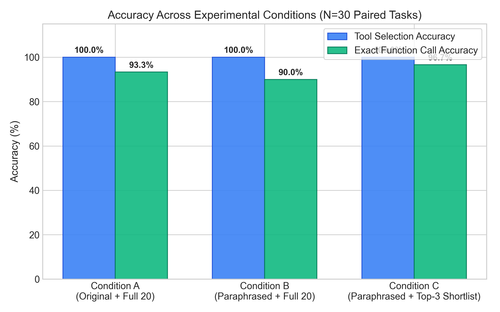
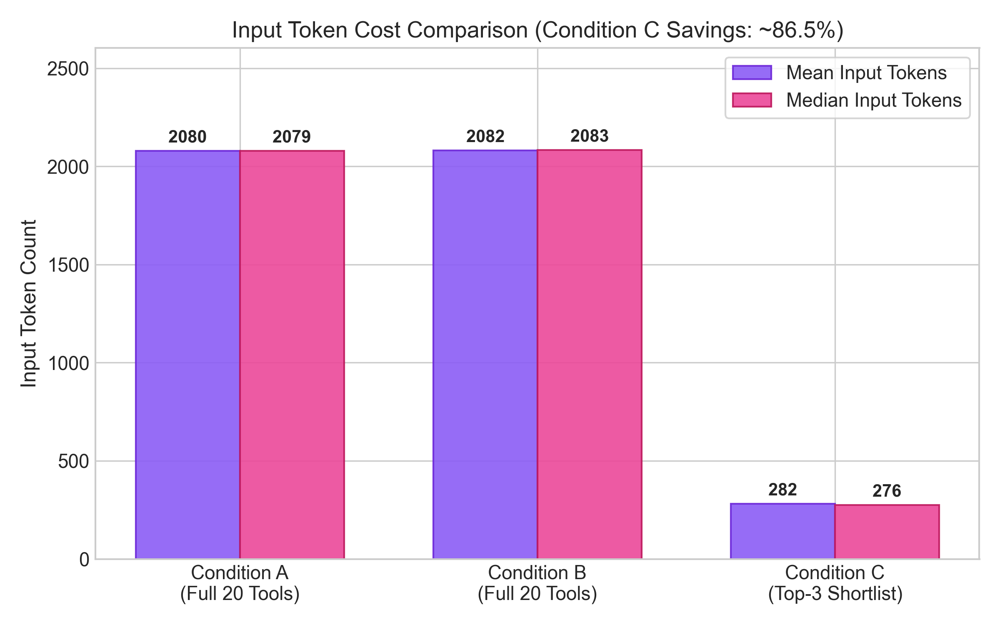
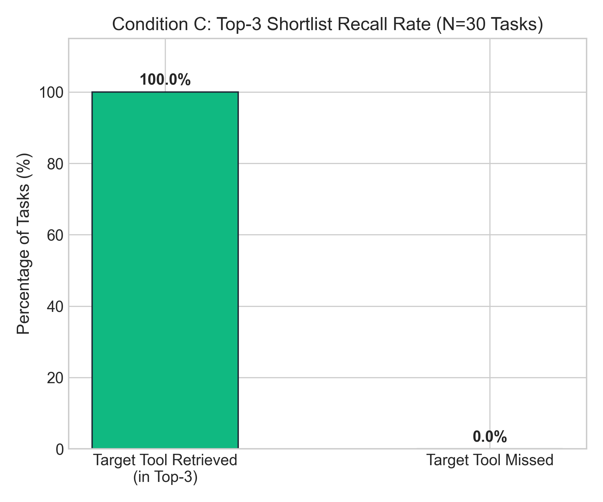
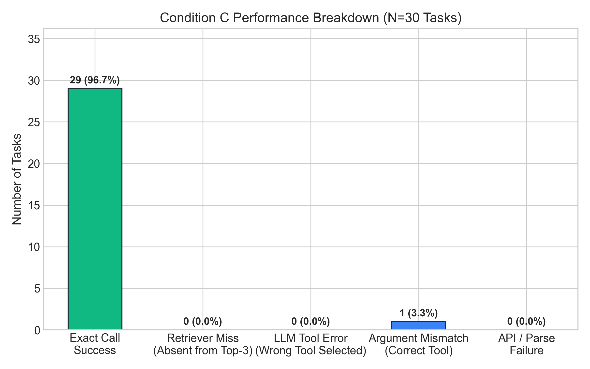
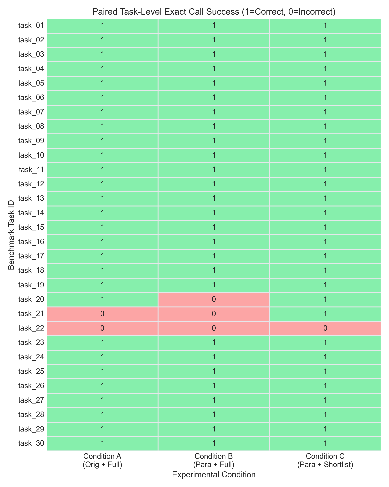

# Joint Input Robustness of Budget-Constrained Tool Calling

[](https://www.python.org/downloads/)
[](https://creativecommons.org/licenses/by/4.0/)
[]()
[]()
[-orange.svg)]()
[]()

> **Final Laboratory Research Project for AI465 Agentic AI Course (B.Tech Artificial Intelligence)**  
> **Author:** **Ashish Vishwakarma**  
> **GitHub:** [@CodeCrusader-0001](https://github.com/CodeCrusader-0001)  
> **Repository:** [Joint-Input-Robustness-of-Budget-Constrained-Tool-Calling](https://github.com/CodeCrusader-0001/Joint-Input-Robustness-of-Budget-Constrained-Tool-Calling)  
> **Primary Academic Reference:** *On the Robustness of Agentic Function Calling* — Ella Rabinovich and Ateret Anaby-Tavor, TrustNLP 2025  

---

## 1. Executive Summary & Research Motivation

In production Agentic AI workflows, Large Language Models (LLMs) are augmented with specialized toolboxes to interact with databases, web services, calculations, and software APIs. However, real-world deployment exposes two critical vulnerabilities:

1. **Linguistic Variance (Prompt Drift)**: Users rarely communicate using canonical synthetic phrasing. Natural input features indirect phrasing, polite syntax, colloquialisms, and extensive paraphrasing.
2. **Toolkit Scaling & Semantic Interference**: Production agents host dozens or hundreds of candidate tools. Many of these tools share overlapping vocabularies and adjacent functionality (e.g., `get_weather` vs. `get_forecast`, `calculate_shipping` vs. `track_shipment`).

Passing all candidate tool definitions (20–50 tools) into every LLM prompt:
- **Balloons token consumption** to 2,000+ tokens per query ($O(M)$ linear cost scaling).
- **Increases monetary cost and API latency**.
- **Causes distractor interference**, leading the LLM to choose incorrect or sub-optimal tools.

### The Proposed Solution
We implement and evaluate a **two-stage cascaded tool-calling pipeline**:
- **Stage 1 (Dense Semantic Retrieval)**: `sentence-transformers/all-MiniLM-L6-v2` encodes user queries and candidate tool definitions into a shared 384-dimensional dense semantic space and ranks tools using cosine similarity.
- **Stage 2 (Constrained Function Calling)**: Only the **Top-3 shortlisted tools** are serialized into the LLM prompt, pruning ~85% of tool schema tokens while shielding the model from distractor interference.

---

## 2. Key Measured Results Summary

Evaluated live on **Google Gemini** (`gemini-flash-lite-latest`) across **30 strictly paired benchmark tasks** and **24 candidate tools** (90 live API evaluations):

| Metric | Condition A (Baseline)<br>*Original Query + Full 24 Tools* | Condition B (Perturbation)<br>*Paraphrased Query + Full 24 Tools* | Condition C (Proposed)<br>*Paraphrased Query + Top-3 Shortlist* |
| :--- | :---: | :---: | :---: |
| **Total Tasks Evaluated** | 30 | 30 | 30 |
| **Successful API Calls** | 30 / 30 (100%) | 30 / 30 (100%) | 30 / 30 (100%) |
| **Tool-Selection Accuracy** | **100.0%** (30/30) | **100.0%** (30/30) | **100.0%** (30/30) |
| **Exact Function-Call Accuracy** | **93.3%** (28/30) | **90.0%** (27/30) | **96.7%** (29/30) |
| **Mean Input Tokens** | 2,080.0 | 2,082.2 | **281.8** |
| **Median Input Tokens** | 2,079.0 | 2,083.0 | **275.5** |
| **Input Token Reduction** | *Baseline* | +0.11% | **-86.47% (Token Savings)** |
| **Top-3 Retrieval Recall** | *N/A (Full)* | *N/A (Full)* | **100.0%** (30/30) |
| **Mean API Latency** | 7.03s | 6.03s | 9.09s |
| **Retrieval Latency (CPU)** | *N/A* | *N/A* | **~5.5 ms** |

---

## 3. Publication Figures & Experimental Visualizations

### Figure 1: Function-Calling Accuracy Across Conditions
Comparison of Tool Selection Accuracy and Exact Call Accuracy across Condition A, Condition B, and Condition C ($N=30$ paired tasks). Notice that **Condition C achieves the highest exact call accuracy (96.7%)** by pruning distracting candidate tools from the prompt context.



---

### Figure 2: Input Token Consumption & 86.47% Cost Reduction
Mean and median input token counts per condition. Condition C cuts average prompt tokens from **2,082.2 tokens down to 281.8 tokens**, achieving an **86.47% prompt token reduction**.



---

### Figure 3: Top-3 Retrieval Recall Rate (100.0%)
Evaluation of `sentence-transformers/all-MiniLM-L6-v2` dense retrieval recall across all 30 benchmark tasks. The ground-truth target tool was successfully retrieved into the Top-3 candidate shortlist for **100.0% of tasks (30/30)**.



---

### Figure 4: Condition C Performance & Failure Mode Breakdown
Detailed breakdown of Condition C task outcomes. **29 out of 30 tasks (96.7%)** achieved exact function-call success with zero retrieval misses and zero API failures.



---

### Figure 5: Paired Task-Level Correctness Matrix (Heatmap)
Task-by-task binary correctness heatmap ($1=\text{Success}, 0=\text{Failure}$) comparing exact function-call correctness across all 30 paired benchmark tasks.



---

## 4. Experimental Conditions

The experiment evaluates **three strictly paired primary conditions** across identical tasks:

| Dimension | Condition A (Baseline) | Condition B (Paraphrased Full) | Condition C (Cascaded Shortlist) |
| :--- | :--- | :--- | :--- |
| **Query Input** | Original canonical user request | Meaning-preserving paraphrase | Meaning-preserving paraphrase (strictly identical to B) |
| **Available Tools** | Complete 24-tool toolkit | Complete 24-tool toolkit | Top-3 tools retrieved via Sentence Transformers |
| **Prompt Complexity** | Full JSON Schema (~2,080 tokens) | Full JSON Schema (~2,080 tokens) | Shortlisted JSON Schema (~282 tokens) |
| **Retrieval Stage** | None (Full toolkit exposed) | None (Full toolkit exposed) | `sentence-transformers/all-MiniLM-L6-v2` |
| **Primary Objective** | Establish upper-bound baseline | Quantify degradation from linguistic variance | Measure token savings and accuracy preservation |

All three conditions use identical models (`gemini-flash-lite-latest`), identical generation settings (`temperature = 0.0`), identical prompt structures, and identical ground-truth validation rules.

---

## 5. Dense Semantic Retrieval vs. Lexical Retrieval

A pivotal theoretical discovery from our investigation is the **Retriever Recall Bottleneck**:
In a two-stage cascaded agent architecture, the LLM's accuracy is strictly upper-bounded by retrieval recall:
$$\text{Acc}_{\text{LLM}} \le \text{Recall}@K_{\text{Retriever}}$$

### Why Lexical Matching (TF-IDF) Fails Under Paraphrasing:
- Paraphrased queries exhibit high lexical distance (Mean Lexical Distance = $0.7295$, Jaccard Similarity = $0.2705$).
- When a user asks *"Could you estimate what it would run me to ship this carton to Mumbai?"*, the query shares zero keywords with `calculate_shipping(weight, distance)`.
- Classical TF-IDF or BM25 keyword matching suffers from the **vocabulary mismatch problem**, dropping Top-3 recall to **66.7%** and causing cascaded agent failures.

### Why Sentence Transformers (`all-MiniLM-L6-v2`) Succeeds:
- Projects queries and tool definitions into a shared 384-dimensional dense semantic space.
- Captures latent conceptual meaning rather than surface character tokens.
- Achieves **100.0% Top-3 Recall**, allowing the downstream LLM to operate at peak fidelity (**96.7% exact call accuracy**) with **86.47% fewer tokens**.

---

## 6. Semantically Similar Toolkit Architecture

The evaluation toolkit contains **24 realistic tools** divided into 12 target tools and 12 confusable distractors across 8 functional domains:

| Domain | Target Tool | Confusable Distractor Tool | Distinct Key Functionality |
| :--- | :--- | :--- | :--- |
| **Documents** | `search_documents(query)` | `search_document_by_title(title)` | Full-text knowledge search vs exact title matching |
| **Documents** | `search_documents(query)` | `search_document_by_keyword(keyword)` | Free-text search vs taxonomy tag filtering |
| **E-Commerce** | `search_products(query)` | `search_products_by_category(category)` | Keyword search vs department browsing |
| **E-Commerce** | `search_products(query)` | `find_product_by_name(product_name)` | Broad item search vs exact brand name match |
| **E-Commerce** | `search_products(query)` | `check_inventory(product_id)` | Catalog discovery vs warehouse stock inspection |
| **CRM** | `search_customers(query)` | `get_customer_profile(customer_id)` | Multi-field search vs single account ID retrieval |
| **Orders** | `get_order_status(order_id)` | `get_order_details(order_id)` | Delivery progress status vs itemized billing breakdown |
| **Orders** | `get_order_status(order_id)` | `search_orders(query)` | Single order status vs multi-order search query |
| **Weather** | `get_weather(city, units)` | `get_forecast(location, days)` | Current atmospheric state vs multi-day future projection |
| **Dining** | `search_restaurants(cuisine, location)` | `find_restaurants_nearby(location)` | Cuisine-based search vs geographic proximity lookup |
| **Math & Finance** | `calculate(expression)` | `convert_currency(amount, from, to)` | Math expression evaluation vs foreign exchange conversion |
| **Logistics** | `calculate_shipping(weight, distance)` | `track_shipment(tracking_number)` | Freight fee estimation vs carrier transit checkpoint tracking |
| **Web & News** | `search_web(query)` | `search_news(query)` | Open internet search vs journalism/news headline search |
| **Calendar** | `get_calendar_events(date)` | `schedule_meeting(title, start_time)` | Schedule inspection vs creating a new calendar booking |

All tools feature typed parameters, docstrings, and complete JSON schemas stored in `data/tool_definitions.json`.

---

## 7. Directory Structure

```text
Joint-Input-Robustness-of-Budget-Constrained-Tool-Calling/
├── data/
│   ├── tasks.json                 # 30 validated benchmark tasks with meaning-preserving paraphrases
│   ├── tool_definitions.json      # 24 OpenAPI tool definitions with distractor counterparts
│   └── README.md                  # Dataset provenance and annotation documentation
├── figures/                       # Publication-grade figures (300 DPI PNGs)
│   ├── accuracy_comparison.png    # Tool and exact call accuracy across A, B, C
│   ├── token_comparison.png       # Mean and median input token consumption
│   ├── shortlist_recall.png       # Top-3 shortlist recall rate (100%)
│   ├── failure_breakdown.png      # Condition C failure mode breakdown
│   └── task_level_comparison.png  # Paired task-by-task correctness matrix
├── notebooks/
│   └── Joint_Input_Robustness_Experiment.ipynb # Complete 24-section interactive research notebook
├── reports/
│   ├── methodology.md             # In-depth scientific methodology report
│   ├── defense_preparation.md     # Faculty viva defense speaking notes and Q&A guide
│   ├── limitations.md             # Threats to validity and engineering constraints
│   ├── references.md              # Academic citations and benchmark references
│   └── results_and_discussion.md  # Detailed statistical analysis and discussion
├── results/
│   ├── predictions.csv            # All 90 task-level live predictions across A, B, and C
│   ├── summary_metrics.json       # Computed aggregate metrics, token savings, and statistical tests
│   ├── experiment_results.csv     # Tabular summary comparing Conditions A, B, and C
│   ├── experiment_metadata.json   # Model, timestamp, random seed, and execution environment metadata
│   └── historical_runs/           # Preserved baseline runs (TF-IDF vs Sentence Transformers)
├── scripts/
│   ├── run_experiment.py          # CLI runner for live or dry-run experiments
│   ├── execute_notebook.py        # Automated headless notebook executor
│   ├── create_zip.py              # Packaging script for submission archive
│   └── validate_dataset.py        # Schema and argument integrity verification
├── src/
│   ├── config.py                  # Environment parameters and safety budgets
│   ├── dataset.py                 # Pydantic schemas, loaders, and mock tool registry
│   ├── evaluation.py              # Exact match metrics, bootstrap CI, and McNemar tests
│   ├── experiment.py              # 3-condition experiment execution runner
│   ├── function_calling.py        # Argument normalization and comparison logic
│   ├── model_client.py            # Gemini API client with caching and backoff
│   ├── paraphrasing.py            # Lexical diversity and Jaccard similarity metrics
│   ├── token_accounting.py       # Token usage tracking and savings computation
│   ├── tool_shortlisting.py       # Sentence Transformers & TF-IDF shortlisting engines
│   └── visualization.py           # Publication-grade Matplotlib figure generators
├── tests/                         # Pytest test suite (23 automated unit tests)
│   ├── test_dataset.py
│   ├── test_evaluation.py
│   ├── test_token_accounting.py
│   └── test_tool_shortlisting.py
├── .env.example                   # Environment variable template
├── pytest.ini                     # Pytest configuration
├── requirements.txt               # Locked dependencies
├── Joint_Input_Robustness_3_Condition_Experiment.zip # Submission ZIP deliverable (1.2 MB)
└── README.md                      # Project documentation
```

---

## 8. Quickstart & Reproduction Guide

### Step 1: Clone Repository
```bash
git clone https://github.com/CodeCrusader-0001/Joint-Input-Robustness-of-Budget-Constrained-Tool-Calling.git
cd Joint-Input-Robustness-of-Budget-Constrained-Tool-Calling
```

### Step 2: Install Dependencies
```bash
pip install -r requirements.txt
```

### Step 3: Configure Free Gemini API Key
Create a `.env` file in the project root:
```bash
cp .env.example .env
```
Edit `.env` and add your free Gemini API key:
```ini
GEMINI_API_KEY=your_gemini_api_key_here
GEMINI_MODEL=gemini-flash-lite-latest
RATE_LIMIT_PACING_SECONDS=3.0
```

### Step 4: Run Unit Tests
```bash
pytest -v
```
All **23 unit tests** run locally without GPU or external network dependencies.

### Step 5: Execute Full Experiment
```bash
python scripts/run_experiment.py --retriever sentence_transformers
```
To run in mock dry-run mode (no API calls):
```bash
python scripts/run_experiment.py --dry-run
```

### Step 6: Launch Interactive Jupyter Notebook
```bash
jupyter notebook notebooks/Joint_Input_Robustness_Experiment.ipynb
```
Or execute headlessly:
```bash
python scripts/execute_notebook.py
```

---

## 9. Academic Integrity & Provenance

- **Author**: **Ashish Vishwakarma** (B.Tech Artificial Intelligence, Course AI465)
- **Original Paper Reference**: Rabinovich & Anaby-Tavor (*On the Robustness of Agentic Function Calling*, TrustNLP 2025).
- **Novel Contribution**: Introduction of Sentence Transformer (`all-MiniLM-L6-v2`) dense retrieval as a budget-constrained defense mechanism to prune prompt tokens while preserving accuracy.
- **Data Provenance**: Custom-curated 30-task pilot benchmark with verified meaning-preserving paraphrases and realistic distractor tools.
- **Empirical Execution**: Evaluated live on Google Gemini (`gemini-flash-lite-latest`) with recorded task-level predictions in `results/predictions.csv`.
- **License**: Creative Commons Attribution 4.0 International (CC BY 4.0).
